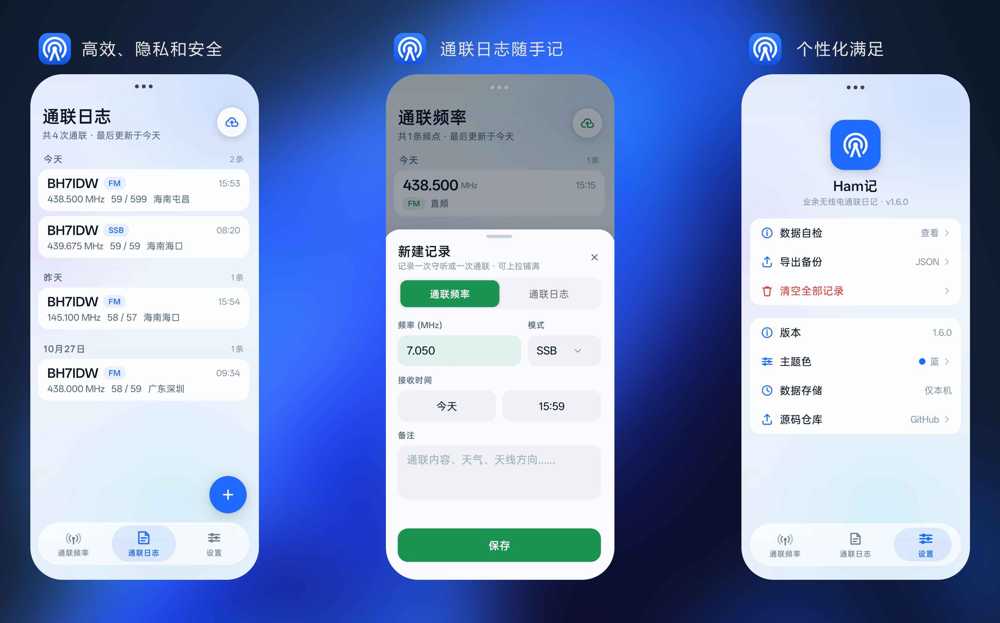

<div align="center">


<h1>Ham记</h1>

<p><b>业余无线电通联日记 · 完全离线 · 零权限 · 约 6 MB</b></p>

<p>用 C# / .NET 10 for Android 原生 View 写的通联记录本。<br/>
不用 MAUI，不引任何 AndroidX 依赖，不联网、不申请权限，数据只存在你自己手机里。</p>

<p>
<a href="https://github.com/GEORGEWWWU/HamQSO/releases/latest"></a>
<a href="https://github.com/GEORGEWWWU/HamQSO/releases/latest"></a>
<a href="#快速开始"></a>
<a href="#项目结构"></a>
</p>

<p>
<a href="#功能">功能</a> ·
<a href="#截图">截图</a> ·
<a href="#快速开始">快速开始</a> ·
<a href="#构建">构建</a> ·
<a href="#数据存储">数据存储</a> ·
<a href="#项目结构">项目结构</a>
</p>

</div>

---

## 功能

<div align="center">

| 记录 | 管理 | 个性化 |
|:---:|:---:|:---:|
| 频点 / 通联日志两类 | 实时搜索 · 日期筛选 | 7 套主题色 |
| 上下行频率、CTCSS、哑音 | 按天折叠 · 长按编辑 · 左滑删除 | 明暗跟随系统 |
| 呼号、RST、QTH、设备、功率、天线 | 导入 / 导出 · 空态引导 | 纯色无渐变 |
| 备注、时间戳 | 列表懒加载 · 滚动回收 | 启动静默检查更新 |

</div>

- **两类记录**：通联频率（频点，含上下行、CTCSS、哑音、模式）与通联日志（QSO，含呼号、RST、QTH、设备、功率、天线、备注）。
- **输入实时约束**：频率/功率只接受数字与一个小数点；呼号只接受字母、数字与 `/` 并自动大写；中文输入法的全角字符自动折半角。
- **编辑时锁类型**：已保存的记录不能从日志改成频点，反之亦然。
- **数据完全本机**：唯一权限是 INTERNET，只用于启动时与手动「检查更新」；无第三方 SDK。

## 截图

<div align="center">

</div>

## 快速开始

```
https://github.com/GEORGEWWWU/HamQSO/releases/latest
```

下载最新 APK，手机上允许「未知来源」后安装即可。首次打开会生成两条示例记录，长按可编辑，左滑可删除。

## 构建

```bash
dotnet build HamJi.csproj -c Release \
  -p:AndroidSdkDirectory=<sdk> \
  -p:JavaSdkDirectory=<jdk17>
```

产物：`bin/Release/net10.0-android/com.hamji.app-Signed.apk`

- minSdk 21（Android 5.0） / targetSdk 36（Android 16）
- ABI：arm64-v8a + armeabi-v7a 单包
- 需要 JDK 17 与 Android SDK（.NET 10 for Android 工作负载）

## 数据存储

记录写在 `/data/data/com.hamji.app/files/records.json`，**原子写入**（先写临时文件再 rename），断电也不会写坏。
设置页可导出 / 导入 JSON 做备份。

## 项目结构

```
Core/        Dui（UI 工具箱）、Store（数据）、AppTheme、Filters（输入约束）
Pages/       首页各分页（频点、日志、设置）
Views/       列表卡片、分段控件、小组件
Resources/   纯手写 drawable / values，不用 AndroidX
NewRecordActivity.cs  底部弹层式新建 / 编辑页
```

## 变更记录

### v1.0.2

- **按天折叠**：通联频率 / 通联日志页的每一天都可点击折叠，右侧细线小箭头随状态旋转
- 条数计数改为日期标题旁的浅色标签；列表折叠 / 展开带高度过渡动画，可随时点击打断
- **懒加载**：只渲染视口附近的内容，滚动时按块补入并淡入显示；滑到很上方时回收行释放内存，回滚自动重建
- 排版缓存：分组高度只在内容变化时重算，长列表滚动不再反复测量
- **搜索页**（新 tab）：顶部搜索框 + 日期筛选按钮，输入即实时检索频率 / 模式 / 备注（日志另含呼号与 QTH）；
  日期用屏幕正中的悬浮月历筛选；顶部常驻小尺寸分类下拉（全部 / 通联频率 / 通联日志），
  结果按「通联频率 / 通联日志」分组显示

### v1.0.1

- **应用内自动更新**：发现新版本弹窗提示（不再提示 / 点击更新），原地下载并显示进度，完成后覆盖安装
- **导入恢复**：设置页可选择 JSON 备份，支持合并（按 Id 去重）或覆盖恢复
- **桌面长按快捷方式**：新频率 / 新日志，直达对应页并打开新建弹层
- 新建页类型跟随来源页面，模式默认 FM；自绘日期 / 时间选择器替换系统弹窗
- 启动默认进入通联日志页；修复导航滑块尺寸、设置页顶部留白等若干问题

### v1.0.0

首个正式版。包含：两类记录、实时输入约束、编辑锁类型、7 套主题色、导入导出、明暗跟随系统。

<div align="center">

<sub>用 .NET 10 for Android 手写 · 为业余无线电爱好者</sub>

</div>
